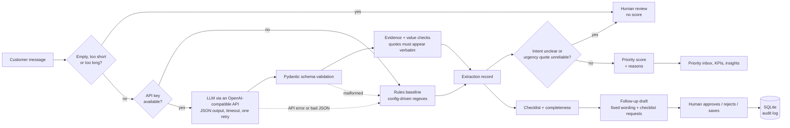

# Speed-to-Quote: AI Intake Copilot for Commercial Trucking Insurance

> **SYNTHETIC / DEMONSTRATION DATA ONLY.** This is an independent portfolio project inspired by the problems that
> fast-growing commercial insurance brokerages face. It is **not** an official project of any company and uses **no**
> company's internal data. Every business, person, phone number and email in it is fictional.
>
> The system **never decides insurance eligibility, premiums, coverage terms or underwriting outcomes, and it never
> sends any email or message.** A human reviews and approves everything.

## The problem

Brokers receive incomplete, unstructured inquiries ("we run 12 trucks in Texas and Oklahoma, our insurance expires next
month, we need a quote this week"). Someone has to read each message, work out what the customer wants, notice which
business information is missing, decide what to handle first, and write a follow-up asking for the missing items. Doing
this by hand adds delay and back-and-forth, and for a brokerage whose selling point is speed on complex lines, that
delay is the product.

## The solution

An engine that helps a **human broker** turn an unstructured trucking-insurance inquiry into a **structured, reviewable
submission record**, ranked by operational urgency, with a **follow-up draft a human approves**. This repository contains
both the back-end engine and a four-page Streamlit user interface (see [User interface](#user-interface) and
[Using the engine from a user interface](#using-the-engine-from-a-user-interface)).

| Package | What it does |
|---|---|
| `src/extraction` | Turns a message into intent, urgency, a deadline and 12 checklist fields, each with a supporting quote. LLM (any OpenAI-compatible API, Gemini by default) with a deterministic rules baseline as offline fallback. |
| `src/scoring` | Review routing, the explainable 0–100 priority score, and checklist completeness. |
| `src/drafting` | Follow-up drafts (template or LLM-assisted grouping), a content safety scan, the draft approval workflow and the audit log. |
| `src/database` | SQLite schema, migrations and read/write helpers. |
| `src/analytics` | KPIs from event timestamps, the ranked priority inbox, and rule-based insights. |
| `src/evaluation` | Export of 80 unlabeled evaluation messages, label validation, a cache of LLM answers, metrics and failure cases. |
| `src/data_generation` | Reproducible synthetic inquiries with consistent event histories. |
| `config/` | The checklist, priority weights and rules patterns as YAML, so another insurance line can be added without code changes. |
| `app/` + `streamlit_app.py` | Four-page Streamlit front end: Inquiry Triage, Submission Review, Operations Overview, and Model Evaluation. |

Without an API key everything runs in **offline mode** (rules baseline), and the system never crashes because the LLM is
unavailable.

## Architecture



No agent frameworks and no paid infrastructure: Python, SQLite, Pandas, Pydantic, Plotly, Streamlit, Pytest, and a plain
`requests` client for any OpenAI-compatible API.

### How extraction stays honest

1. The LLM must return JSON matching a Pydantic schema; anything malformed falls back to the rules baseline and is logged.
2. **Every non-missing field needs a quote copied exactly from the message** (only runs of whitespace are collapsed).
   Code checks it. A quote that is not in the message turns the field into `unclear` and drops the claimed value.
3. **Targeted value checks:** for fleet size, operating states and DOT/MC numbers, a real quote must also support the value
   ("12 trucks and 99 drivers" cannot justify a fleet size of 99; a state list must appear in its quote), and "not
   applicable" is accepted only when the quote matches the field's configured non-applicability wording (for example "just
   got our authority" for loss runs). Other fields rely on the verbatim-quote check alone.
4. **Dates are resolved by code, not by the model.** The model returns the customer's own words ("next month"); the code
   turns them into a date. A vague phrase becomes a range (1–31 December) flagged as approximate; a date counts as a
   deadline only if the surrounding words make it one ("expires", "need it by"), not history ("we bought a truck on
   March 3"). Negated or name-embedded time words ("not urgent", "Today Transport LLC") are ignored.
5. If the model's quote for its intent label is invented, intent becomes `unclear` and the inquiry goes to human review.
6. A range, a bound ("over 20 trucks") or two different counts is reported as `unclear` rather than as one number.

## How the priority score works

`score = urgency + deadline + waiting + follow-up`, a transparent weighted sum that adds up to at most 100. Weights live in
`config/priority_weights.yaml` (the loader refuses weights that do not total 100). Each factor is shown with its points
and a reason, e.g. `+30: deadline ("next month") is 29 days away at the earliest (approximate; confirm the exact date)`.

| Factor | Max | How points are given | Why this weight |
|---|---:|---|---|
| **Deadline** | 40 | Stepped by days left: ≤7 d = 40, ≤14 = 35, ≤30 = 30, ≤60 = 18, ≤90 = 8, otherwise 0. A deadline that lapsed up to 30 days ago still gets 40; older lapses get 0 ("likely stale"). | A concrete date (policy expiry, callback) is the most objective urgency signal; a coverage lapse is costly for the customer and a complex line needs lead time. Stepped, so "this week" clearly outranks "next month". |
| **Urgency** | 25 | High 25, medium 12, low 0 (the customer's own stated urgency). | It shows how the customer wants to be treated, but it is self-reported and cheap to claim, so it weighs less than a verifiable date. |
| **Waiting** | 20 | Linear from 0 at 0 h to 20 at 48 h with no first response; 0 once answered. | Speed is the brokerage's differentiator, so unanswered inquiries rise the longer they wait, capped so one old message cannot swamp the rest. |
| **Follow-up** | 15 | Overdue 15, due within 24 h 8, none 0. | A promised follow-up that is overdue is a broken commitment to a customer already in the funnel. It only applies after a first response, hence the smaller weight. |

**This is operational urgency (how soon a person should look at it). It is not a prediction of conversion, deal size or
customer quality**, and no personal or protected attribute is used.

## The checklist and why it looks like this

Twelve fields commonly requested for a trucking submission: business legal name, USDOT / MC number, operating states,
radius of operation, commodities hauled, fleet size, vehicle schedule (types, years), driver information (count,
experience), requested coverages, desired effective date, current / prior coverage, and loss runs (prior claims history,
*when applicable*, so it is "not applicable" for a brand-new venture). Each field is `provided`, `missing`, `unclear` or
`not_applicable`; completeness is `provided ÷ applicable`.

> This checklist reflects information commonly requested for trucking submissions. It does **not** represent universal
> carrier requirements: each carrier or underwriter may ask for different or additional items. "Complete" here means
> **ready for human review, not ready for a bindable quote.**

**Future extension (not built):** because the checklist is a config file, another line such as general liability could be
added as a sibling YAML file without changing code. Only trucking exists today.

## Human in the loop

* Follow-up drafts ask **only** about missing or unclear fields, grouped into a few bullets, and never re-ask what is
  provided. Wording is fixed text plus the checklist's own request phrases; the LLM only chooses the grouping.
* A deterministic safety scan blocks prices, premiums, coverage promises, eligibility talk, time commitments and dates the
  customer did not write. It is enforced inside `approve_draft` (the backend), not just shown as a warning.
* A draft goes **outdated** if the checklist changes after it was written, and cannot be approved until regenerated.
* Every action (generate, save, approve, reject, field correction) is written to an append-only **audit log**: timestamp,
  inquiry id, action, the original generated text, the text at the time of the action, and the reason.
* **Nothing is ever sent.** "Approved" only records that a person signed the text off.

## Operations KPIs

Computed from event timestamps (never hard-coded), for inquiries received in a chosen period: total inquiries; median and
P90 first-response time (answered inquiries only; inquiries with no response are reported separately as open-and-awaiting
versus closed-without-one); overdue follow-ups (count, percentage, numerator and denominator); average completeness; volume
by intent; and quote-request-to-bound rate for **mature cohorts only** (requests at least 45 days old, so outcomes have had
time to occur; the cohort definition travels with the number). The four insights are rule-based, descriptive and
hypothesis-labelled: no causal claims, no revenue estimates, and every figure comes from a computed metric.

## Evaluation

**Method.** 80 synthetic messages, generated separately from the operational data (a different seed, with no message in
common), are exported to `eval/eval_unlabeled.csv` with **empty** label columns. They are to be labelled by hand (intent,
urgency and the status of each checklist field; definitions in `eval/LABELING_GUIDE.md`) and saved as
`eval/eval_labeled.csv`. Nothing in this project pre-fills, suggests or generates a label. The code then compares the LLM
pipeline (as deployed: the model's answer after validation and evidence checks, falling back to rules if the answer is
unusable) with the rules baseline on: intent accuracy, macro-F1 and confusion matrix; urgency accuracy and macro-F1;
missing-field precision and recall (positive class = field is missing or unclear); invalid / malformed LLM response rate;
and median latency per inquiry, reported both as API-call time and as the full application path. LLM answers are cached in
`eval/llm_cache.json`, so results are reproducible and building the report never calls the API.

**Results so far.** The labels do not exist yet, so **no accuracy figure is reported here: nothing is estimated.** What has
been measured, with no labels needed, from one cached run of `gemini-3.5-flash-lite`:

| Measurement | Result |
|---|---|
| Messages the app sends to the LLM | 79 of the 80. One ("can someone call me") is too short, so the app answers it with the rules baseline and never calls the API; the evaluation does the same. |
| API errors | 0 of 79 |
| Malformed responses (failed JSON / schema validation) | 0 of 79 (0.0%). **This means the output matched the schema. It says nothing about whether the extracted values are correct.** |
| Median API-call latency (cached, historical) | about 2.9 s (maximum about 6.9 s) |
| Median full-pipeline latency per inquiry (API call + validation and evidence checks, or rules time when rules answer) | about 2.9 s |

Evaluation mirrors the app exactly: short messages go to rules, API errors and malformed answers fall back to rules, and a
test confirms that for all 80 messages the evaluation's prediction equals what the app's own extraction returns. Once
`eval/eval_labeled.csv` is in place, `python -m src.evaluation.run_eval --report` produces the comparison; the table below
is to be filled from that output, not before.

| Metric | LLM pipeline | Rules baseline |
|---|---|---|
| Intent accuracy / macro-F1 | *awaiting labels* | *awaiting labels* |
| Urgency accuracy / macro-F1 | *awaiting labels* | *awaiting labels* |
| Missing-field precision / recall | *awaiting labels* | *awaiting labels* |

**This sample is small (80 examples), so any metric is indicative only.**

## User interface

Run the four-page Streamlit interface from the repository root:

```bash
streamlit run streamlit_app.py
```

On first launch, if `data/speed_to_quote.db` does not exist, the app builds the deterministic 250-inquiry synthetic
database automatically.

**Environment variables (all optional):**

* `GEMINI_API_KEY` (or `LLM_API_KEY`), `LLM_BASE_URL`, `LLM_MODEL`, `LLM_TIMEOUT_SECONDS`: configure the OpenAI-compatible
  LLM client. Without a key the UI shows an `Offline mode: rules-based` banner and runs entirely offline.
* `STQ_FORCE_OFFLINE=1`: force offline rules-based mode even when an API key is present.
* `STQ_DB_PATH`: override the SQLite database path (default `data/speed_to_quote.db`).
* `STQ_EVAL_DIR`: override the evaluation directory (default `eval/`).

**Deploying to Streamlit Community Cloud:**

1. Push the repository to GitHub and select `streamlit_app.py` as the main file path.
2. Add `GEMINI_API_KEY` (and optional `LLM_*` settings) in the app's **Secrets** settings (see
   `.streamlit/secrets.toml.example`).
3. SQLite storage on Community Cloud is ephemeral and shared across all visitors: **do not paste real customer or
   personal information.**

## Using the engine from a user interface

The functions a front end needs already exist and are covered by tests:

| Need | Call |
|---|---|
| Analyse a message (LLM or rules, never raises) | `src.extraction.pipeline.run_extraction(text, checklist, received_at, client)` |
| Route to review or score, with per-factor reasons | `src.scoring.triage.triage_inquiry(...)` |
| Analyse a stored inquiry and save the result; reload it without any API call | `src.analysis.analyze_inquiry`, `load_analysis`, `load_open_analyses` |
| Save a pasted message; record a human correction | `src.database.repository.create_pasted_inquiry`, `save_correction` |
| Completeness | `src.scoring.completeness.compute_completeness` |
| Generate, edit, approve or reject a draft; audit trail | `src.drafting.draft.generate_draft`, `src.drafting.workflow.*` |
| KPIs, ranked inbox, insights | `src.analytics.kpis`, `inbox.build_inbox`, `insights.build_insights` |
| Evaluation status and metrics | `src.evaluation.report.build_report` |

Notes for whoever builds the interface: open **one SQLite connection per thread** (`src.database.db.connect_app`);
**escape any customer, model or user text before rendering it as markdown or HTML** (messages can contain links, images
and blank lines); show an "offline mode" notice when no LLM is in use; and say plainly that the data is synthetic.

## Testing

`python -m pytest` runs 534 tests covering: database integrity and event-sequence validity; Pydantic validation and
malformed JSON; evidence-quote and value verification; completeness including not-applicable handling; the priority formula
and config-loaded weights; draft approve / reject / save persisting to the audit log; KPI maths (medians, P90, zero
denominators, open inquiries with no response); empty or very short input and behaviour with no API key; schema migration;
the evaluation export, label validation, metrics with known answers and the LLM cache; an edge-case suite (hostile and
odd input, size limits, concurrent writers, label files saved with different spreadsheet settings, config validation, many
wordings of fleet sizes, states, dates and urgency, and inbox speed); and the Streamlit UI (`AppTest` coverage across all
four pages, including the awaiting-labels state of the evaluation page). Tests that need labels use temporary folders and
never touch `eval/`.

## Limitations

* **Synthetic text.** Messages are generated, not written by real customers; real inquiries will be messier. The rules
  baseline and the message generator were written together, so the baseline probably looks better on this data than it
  would on real data.
* **The synthetic history contains assumptions I put in** (faster response is slightly more likely to bind; fuller
  submissions are slightly more likely to be quoted). Patterns in the analytics can therefore reflect the generator, not a
  discovery. The insights say so.
* **Small evaluation set, one labeller, one cached model run.**
* **Input limits.** Messages over 10,000 characters are not analysed automatically (and never sent to the LLM); they go to
  human review.
* **Heuristic language rules.** Deadline and urgency context checks are sentence-level keyword rules; unusual phrasing can
  slip through. Vague deadlines score from their earliest plausible day. Dates are read US month-first.
* **LLM provider.** With a key configured, message text is sent to the provider.
* **Not an underwriting system.** No eligibility, pricing or coverage decisions; the checklist is not a carrier requirement list.

## Setup

Python 3.11 or newer.

```bash
pip install -r requirements.txt
python -m pytest                                    # run the tests
python -m src.data_generation.build_database        # (re)build data/speed_to_quote.db (250 synthetic inquiries)
python -m src.demo_cli "Hi, we run 12 trucks in Texas and Oklahoma. Our insurance expires next month and we want a quote this week."
streamlit run streamlit_app.py                      # launch the four-page web UI
```

**LLM (optional).** Copy `.env.example` to `.env` and set `GEMINI_API_KEY`. `LLM_BASE_URL` and `LLM_MODEL` point the client
at any OpenAI-compatible API; the default model is `gemini-3.5-flash-lite`. Keys are never printed, logged or committed.
Without a key the engine runs in offline mode.

**Evaluation.**

```bash
python -m src.evaluation.export             # re-export the unlabeled set (identical each time)
python -m src.evaluation.run_eval           # call the API for uncached messages and fill eval/llm_cache.json
python -m src.evaluation.run_eval --report  # print the evaluation status (no API calls)
```

## Repository layout

```
speed-to-quote/
  app/                   Streamlit front end (pages, charts, state, escaping helpers)
  config/                checklist, priority weights, rules baseline patterns, settings
  data/                  generated SQLite database (git-ignored, rebuilt on demand)
  eval/                  unlabeled eval set, labelling guide, cached LLM answers (+ your eval_labeled.csv)
  src/
    data_generation/     synthetic messages, event histories, database build
    database/            schema, migrations, repository
    extraction/          LLM client, schema, evidence checks, deadlines, rules baseline, pipeline
    scoring/             priority score, triage routing, completeness
    drafting/            draft generation + safety scan, approval workflow, audit log
    analytics/           KPIs, priority inbox, insights
    evaluation/          export, label validation, cache, metrics, report
  tests/                 pytest suite (engine + Streamlit AppTest UI suite)
  docs/                  founder memo
  streamlit_app.py       Streamlit entry point
```

## Future work

* Label the 80 messages, report the real comparison, then use the failure cases to improve the rules and the prompt.
* Evaluate on a small set of real (anonymised, consented) inquiries before trusting any number.
* Persistent storage and per-user sign-in for a real deployment; email intake instead of paste.
* A second insurance line as another checklist YAML file (the code is already config-driven).
